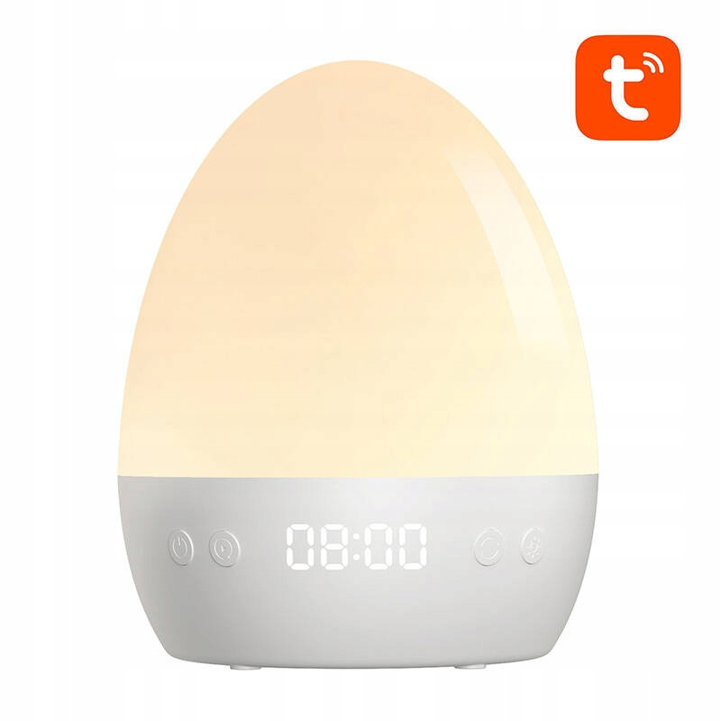
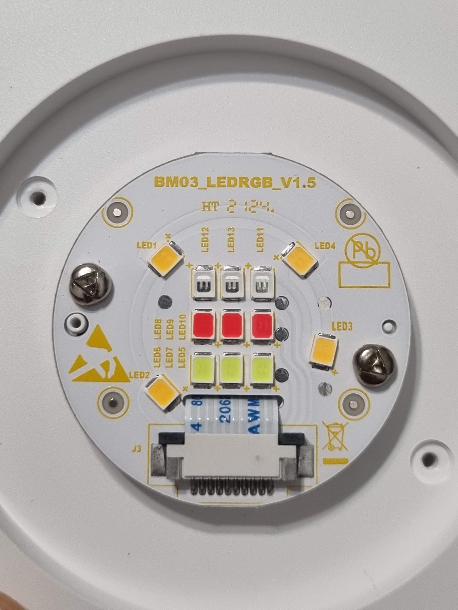

# SmartNightLight

Custom ESP32-S3 replacement controller for the Gosund LB2S Tuya RGBW Smart Night Light.

This project replaces the original Tuya-based controller inside the Gosund LB2S with a custom ESP32-S3 running ESPHome.

The modification preserves the original RGBW lighting functionality while adding a completely local smart-home integration and network audio playback through Music Assistant Sendspin.

### Original Device

- **Manufacturer:** Gosund
- **Model:** LB2S
- **Product:** Wi-Fi RGBW Smart Night Light
- **Original platform:** Tuya / Smart Life
- **Wi-Fi:** 2.4 GHz
- **Power input:** 5V / 1A
- **Lighting:** RGB + warm white (2700K)

### Hardware Modification

The original Tuya controller is replaced with:

- ESP32-S3 DevKitC-1
- 16 MB flash
- Octal PSRAM
- Custom ESPHome firmware
- MAX98357A I²S mono audio amplifier

The original RGBW lighting channels are controlled independently using ESP32-S3 LEDC PWM outputs.

### Added Functionality

- Local control through ESPHome and Home Assistant.
- Independent RGBW lighting control.
- Smooth brightness and color transitions.
- Music Assistant Sendspin integration.
- Network audio streaming.
- Synchronized multi-room audio playback.
- MAX98357A mono audio output.
- OTA firmware updates.
- Wi-Fi signal monitoring.

### Project Goal

Transform the Gosund LB2S from a cloud-dependent Tuya smart night light into a locally controlled ESPHome device with integrated Music Assistant audio capabilities.

**No Tuya cloud dependency is required for the custom firmware.**

Original product: [Gosund LB2S – FashionPolska](https://fashionpolska.pl/p/175894756/gosund-inteligentna-lampka-nocna-wifi-2-4ghz-rgbw-16m-lb2s-tuya-led)
